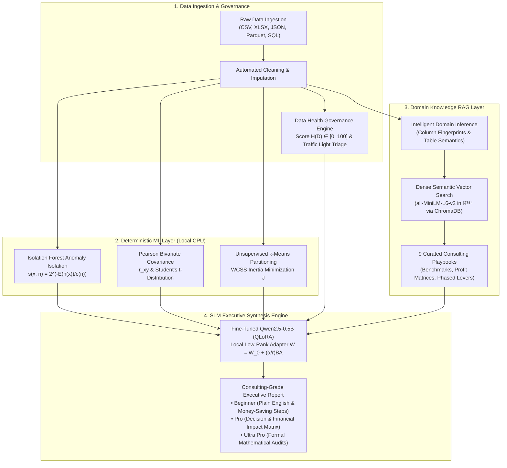

# 🧠 GYAN Analytics

> **Autonomous Enterprise Business Intelligence & Algorithmic Decision Platform**  
> *Transforming raw multi-dimensional data into high-ROI executive decisions using deterministic machine learning, Domain Knowledge RAG, and fine-tuned Small Language Models (SLMs).*

[](https://github.com/GAGAN7350/GYANS_ANALYTICS/actions)
[](https://www.python.org/)
[](https://fastapi.tiangolo.com/)
[](https://react.dev/)
[](https://pytorch.org/)
[-FF6F00)](https://huggingface.co/)
[-orange)](https://www.trychroma.com/)
[](LICENSE)

---

## ⚡ The Big Picture: Why GYAN Analytics?

Traditional Business Intelligence (PowerBI, Tableau) displays retrospective historical charts without prescriptive decision guidance. Conversely, general-purpose LLMs hallucinate calculations when asked to analyze tabular data.

**GYAN Analytics resolves this fundamental trade-off with a Strict Mathematical Duality Principle:**
1. **Deterministic Statistical Layer:** Numerical distributions, Isolation Forest anomaly boundaries, Pearson correlation matrices, and $k$-Means cluster inertia are computed on local CPU with 100% mathematical precision.
2. **Domain Knowledge RAG Layer:** Embeds 9 industry consulting playbooks (Retail, Finance, Healthcare, SaaS, Manufacturing, HR, Education, Religious, Operations) to match data telemetry against sector KPI benchmarks and ROI profit matrices.
3. **Fine-Tuned SLM Narrative Layer:** A specialized 0.5B parameter instruction model (`Qwen2.5-0.5B` fine-tuned via QLoRA) synthesizes the numerical findings and domain playbooks into consulting-grade executive briefs.

---

## 🏗️ System Architecture



---

## 📊 Live Report Output Preview (Pro Tier)

Every generated executive report features a structured, quantifiable roadmap linking data anomalies directly to financial recovery:

### Executive Decision & Financial Impact Matrix

| Strategic Initiative | Operational Lever | Problem Solved / Risk Mitigated | Projected Financial Impact (ROI) | Execution Timeline |
| :--- | :--- | :--- | :--- | :--- |
| **Price & Margin Protection** | Cap promotional discounts & enforce minimum basket thresholds for free shipping | Unprofitable volume growth where aggressive discounts erode gross margin | **+3.5% to +6.0% Gross Margin Recovery across top-selling SKUs** | Phase 1 - Immediate Profit Protection (Days 1-7) |
| **High-LTV VIP Cohort Expansion** | Reallocate acquisition budget toward retaining top 15% VIP shopper segment | High customer acquisition cost (CAC) spent on one-time discount seekers | **+18% to +25% Customer Lifetime Value (LTV) with 30% reduction in churn** | Phase 2 - Strategic Growth & Margin Expansion (Days 8-21) |
| **Deadstock Liquidation & Working Capital Release** | Dynamic automated markdowns on inventory aging past 60 days to clear warehouse slots | Trapped cash flow in slow-moving SKUs increasing holding costs | **Releases 8% to 12% in trapped working capital; cuts carrying costs by 15%** | Phase 3 - Enterprise Efficiency & Governance (Days 22-30) |

### Concrete Prescriptions for Company Leadership

1. **Stop Immediate Margin Leakage (Days 1–7):** Mandate an immediate 5% discount cap on high-velocity items and introduce minimum cart values before free delivery applies. Eliminating unhedged shipping subsidies stops bottom-line slippage.
2. **Capitalize on Core Drivers (Days 8–21):** Reallocate marketing campaigns away from low-margin bargain hunters directly into automated VIP retention perks and personalized bundles for your dominant cohort.
3. **Deploy Automated Inventory Aging Alerts (Days 22–30):** Trigger tiered promotional bundles on items exceeding 60 shelf-days to channel released working capital directly into fast-moving inventory.

---

## 📑 Multi-Tier Report Delivery

| Tier | Target Audience | Key Deliverables |
| :--- | :--- | :--- |
| **Beginner** | Department Leads & Non-Technical Founders | 100% plain English, 4-dimension data health audit, and high-impact money-saving operational steps. |
| **Pro** | C-Suite Executives & Board of Directors | Multivariate correlation drivers, anomaly risk dimensions, cohort segmentation, and the **Executive Decision & Financial Impact Matrix**. |
| **Ultra Pro** | Data Scientists & Quantitative Auditors | Full LaTeX formulations, Isolation Forest scoring parameters, Pearson $t$-statistics, and the **Corporate Alpha Decision Protocol**. |

---

## 📐 Mathematical Foundations Whitepaper

For complete mathematical derivations, loss functions, and algorithmic proofs, review our technical paper:  
📄 **[GYAN Analytics — Mathematical Foundations & Algorithmic Formulations (PDF)](GYAN_Analytics_Mathematical_Foundations.pdf)**

### Key Equations at a Glance:
- **Isolation Forest Anomaly Scoring:**
  $$s(x, n) = 2^{-\frac{\mathbb{E}(h(x))}{c(n)}} \quad \text{where} \quad c(n) = 2\ln(n - 1) + 2\gamma - \frac{2(n - 1)}{n}$$
- **Pearson Product-Moment Correlation:**
  $$r_{xy} = \frac{\sum_{i=1}^n (x_i - \bar{x})(y_i - \bar{y})}{\sqrt{\sum_{i=1}^n (x_i - \bar{x})^2} \sqrt{\sum_{i=1}^n (y_i - \bar{y})^2}}$$
- **$k$-Means WCSS Inertia Optimization:**
  $$J = \sum_{j=1}^k \sum_{x_i \in C_j} \|x_i - \mu_j\|_2^2$$
- **Low-Rank Adaptation (LoRA):**
  $$W = W_0 + \Delta W = W_0 + \frac{\alpha}{r} B A \quad (\text{Rank } r = 16, \text{Scaling } \alpha = 32)$$

---

## 📁 Repository Structure

```text
GYANS_ANALYTICS/
├── backend/
│   ├── app/
│   │   ├── api/                 # FastAPI REST Endpoints (Auth, Datasets, AI Insights, Dashboards)
│   │   ├── core/                # App Configuration, Database, Security & CORS Settings
│   │   ├── knowledge_base/      # 9 Curated Domain Consulting Playbooks (.json)
│   │   ├── models/              # SQLAlchemy Database ORM Models
│   │   ├── schemas/             # Pydantic Request/Response Validation Schemas
│   │   └── services/
│   │       ├── ml_engine/       # Pattern Recognition, Decision Engine, Domain RAG, LLM Inference
│   │       ├── dataset_service.py
│   │       └── workspace_service.py
│   ├── tests/                   # Pytest Automated Test Suite
│   └── requirements.txt         # Backend Python Dependencies
├── frontend/
│   ├── src/
│   │   ├── components/
│   │   │   ├── dataset/         # ReportViewer, ChartBuilder, DatasetDetail, TemplateStudio
│   │   │   ├── dashboard/       # Drag-and-Drop Dashboard Canvas
│   │   │   └── auth/            # Login, Signup, AuthGuard
│   │   ├── services/            # Axios API Connectors (aiService, datasetService)
│   │   └── stores/              # Zustand Global State Management
│   └── package.json             # Frontend React 18 & Vite Dependencies
├── gyan_analytics_model_v2/     # Fine-Tuned PEFT LoRA Weights & Tokenizer
├── docker/                      # Multi-Container Production Docker Setup
├── GYAN_Analytics_Mathematical_Foundations.pdf  # Technical Whitepaper
└── README.md
```

---

## 🚀 Quick Start Guide

### Prerequisites
- **Python:** 3.12 or higher
- **Node.js:** 20.x or higher
- **Git**

### 1. Clone & Set Up Environment
```bash
git clone https://github.com/GAGAN7350/GYANS_ANALYTICS.git
cd GYANS_ANALYTICS
cp .env.example .env
```

### 2. Launch Backend (FastAPI)
```bash
cd backend
python -m venv venv
# On Windows:
.\venv\Scripts\activate
# On Linux/macOS:
source venv/bin/activate

pip install -r requirements.txt
python -m uvicorn app.main:app --host 127.0.0.1 --port 8000 --reload
```
*Backend API Docs will be live at: [http://127.0.0.1:8000/docs](http://127.0.0.1:8000/docs)*

### 3. Launch Frontend (Vite + React)
```bash
cd ../frontend
npm install
npm run dev
```
*Application UI will be live at: [http://localhost:3000](http://localhost:3000)*

### 4. Run Automated Test Suite
```bash
cd ../backend
python -m pytest tests/
python -m ruff check --config pyproject.toml .
```

---

## 👥 Authors & Credits

Developed by **GYAN Analytics Team (MPR_CS_26_T7)**:
- **Gagan G** ([@GAGAN7350](https://github.com/GAGAN7350))
- **Esha Kumara**
- **Bharathkumar G**
- **Atharva Joshi**

---

## 📄 License

This project is licensed under the **GNU Affero General Public License v3.0 (AGPLv3)** — see the [LICENSE](LICENSE) file for details.
